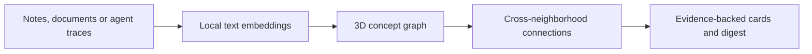

# Cortex

### Turn a folder of notes into a 3D map of ideas—and find connections you missed.

[**Try the demo →**](https://cmonaco0317.github.io/cortex-mind/) · [Technical notes](TECHNICAL.md)


Cortex makes documents explorable. Concepts become points in a live 3D graph;
related concepts connect. A curiosity engine moves through the map and surfaces
pairs that connect otherwise separate neighborhoods. Each connection comes with
source snippets and an explanation you can export as a Markdown digest.

**The interesting part:** go from “here are my notes” to “these two ideas belong
together” without sending your notes to an AI service.

## Try it in a minute

1. [Open Cortex](https://cmonaco0317.github.io/cortex-mind/) and explore the bundled map.
2. Open an Insight Card to see a connection and its supporting material.
3. Choose **＋ your data** to build a map from your own text or files.
4. Export the Insight Digest to keep the connections outside the visualization.

The demo starts with a 237-concept example built offline. Your own data follows
the in-browser embedding path. Model files are bundled with the app; processing
stays in your browser, with no account or API key.

## How it works



- **Local embeddings:** Transformers.js and a bundled MiniLM model encode your text.
- **An explorable map:** Three.js renders concepts, associations, and activation.
- **A useful output:** connection scores combine relatedness and neighborhood overlap.

This is an exploratory tool, not a conscious brain or proof that a connection is
meaningful. Read the supporting text. The bundled example's stored scores predate
the current scoring formula; [the differences are documented](docs/bridge-score-baseline.md).

## Run locally

Requires Node.js and npm.

```bash
git clone https://github.com/cmonaco0317/cortex-mind.git
cd cortex-mind/frontend
npm ci
npm run dev
```

Open the address Vite prints. `npm test` runs the frontend suite;
`npm run build` produces the static app. The Python pipeline and checks are
explained in [TECHNICAL.md](TECHNICAL.md).

Built with AI coding assistance, including Claude Code. Shared as a portfolio
snapshot; no ongoing service or maintenance schedule is promised. [MIT](LICENSE).
